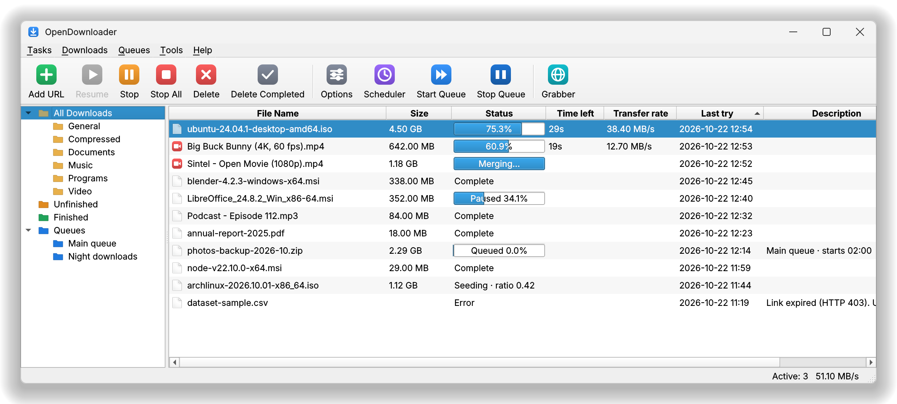
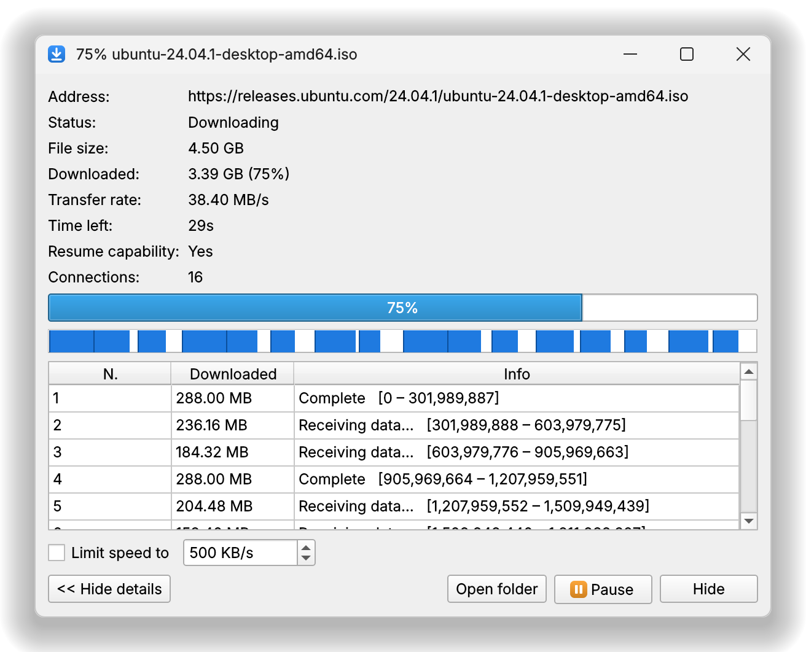
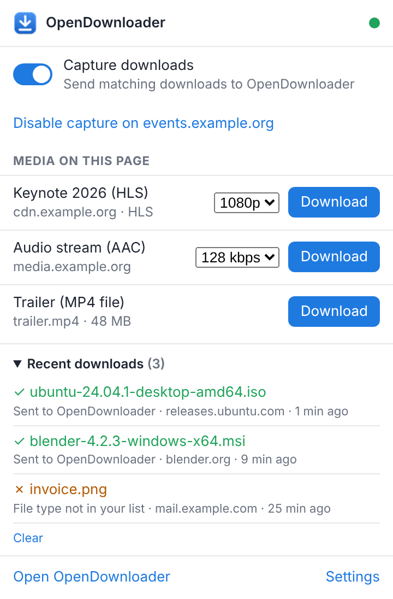
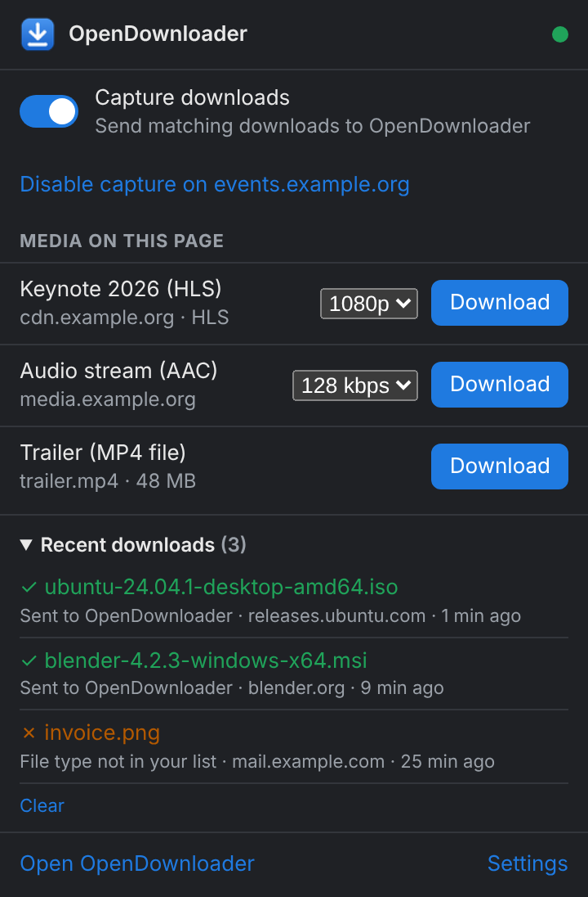
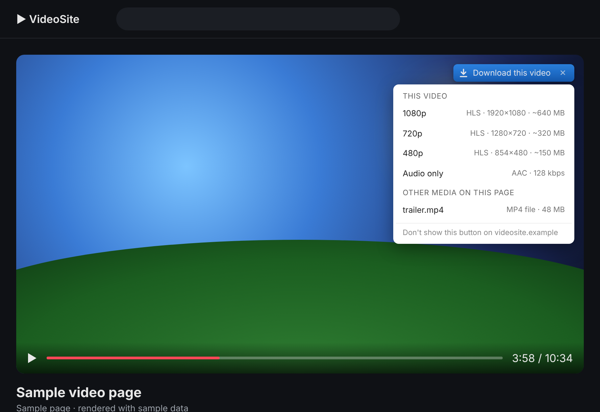
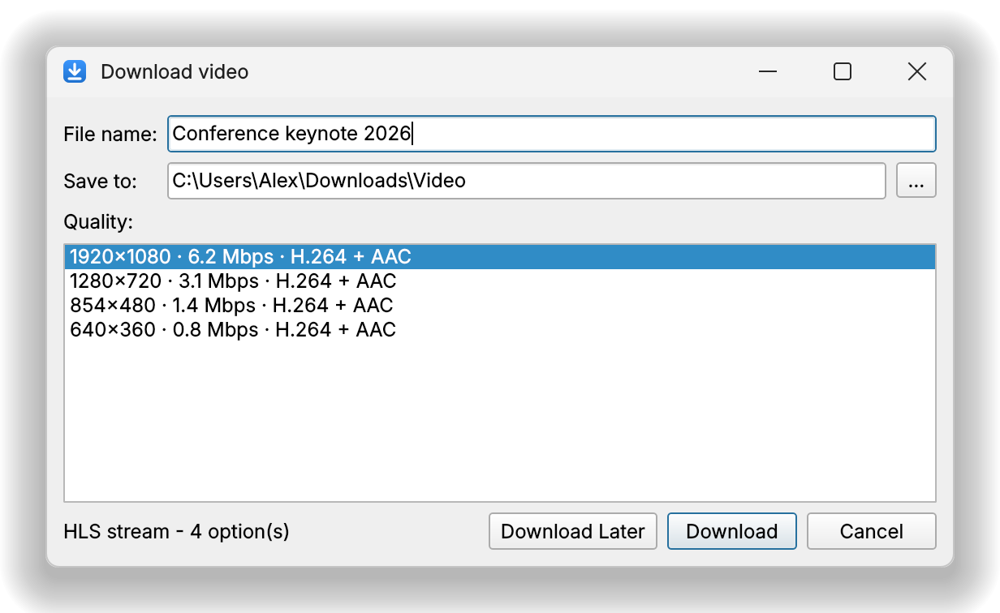
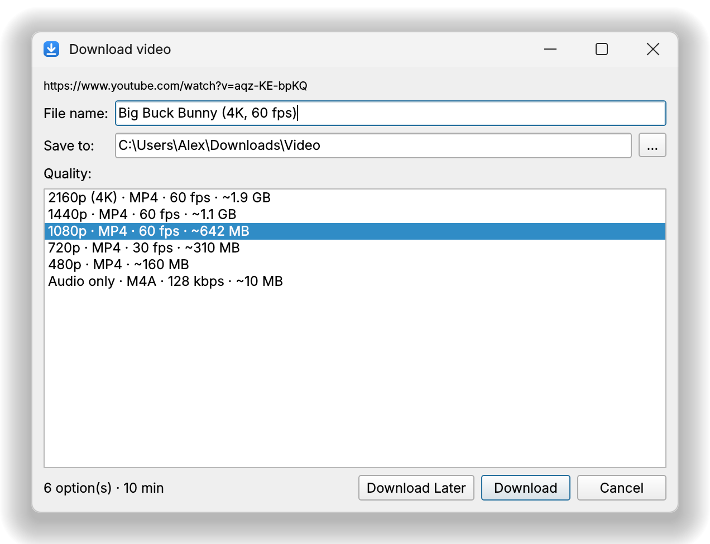
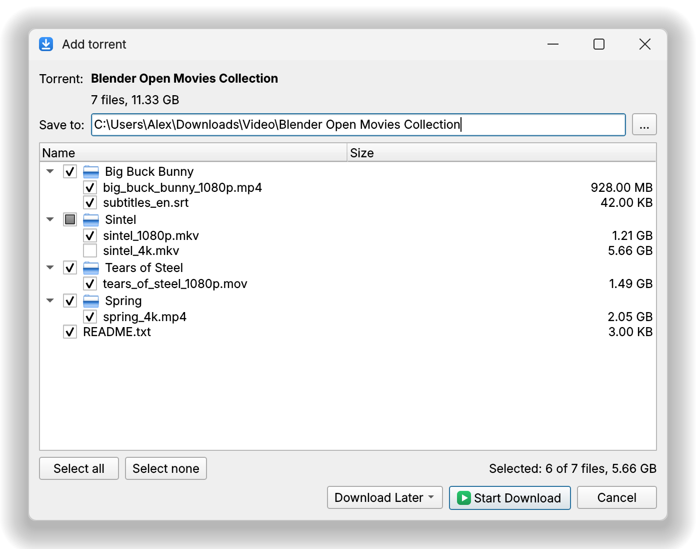
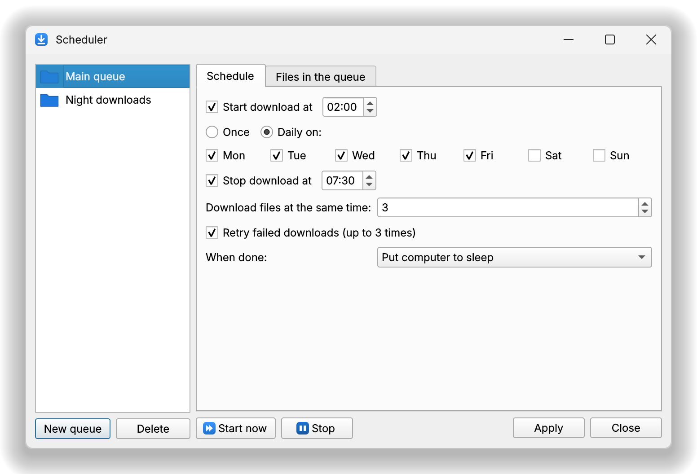

<div align="center">


# OpenDownloader

### Free, open-source download manager for Windows

**Faster downloads with up to 32 connections · Pause and resume · Browser integration · Video downloader for HLS, DASH and YouTube · Torrents · Queues and scheduler**

<br>

<a href="https://github.com/ppiku4/opendownloader/releases/latest/download/OpenDownloader-Setup.exe"></a>
&nbsp;
<a href="https://github.com/ppiku4/opendownloader/releases/latest"></a>

<sub>Windows 10 (1903+) and Windows 11, 64-bit · No admin rights needed · About 24 MB</sub>

<br><br>

<a href="https://github.com/ppiku4/opendownloader/releases/latest"></a>
<a href="https://github.com/ppiku4/opendownloader/releases"></a>


<a href="LICENSE"></a>
<a href="https://github.com/ppiku4/opendownloader/stargazers"></a>

<br><br>

<picture>
  <source media="(prefers-color-scheme: dark)" srcset="docs/screenshots/main-window-dark.png">
  
</picture>

<sub>Screenshots show the real OpenDownloader interface with sample downloads.</sub>

<br>

**[Download](#-download)** · **[Features](#-features)** · **[Install](#-install-in-2-minutes)** · **[Browser extension](#-add-the-browser-extension)** · **[FAQ](#-faq)** · **[For developers](#-for-developers)**

</div>

---

## What is OpenDownloader?

**OpenDownloader is a free, open-source download manager for Windows 10 and 11.** It speeds up downloads by
splitting each file into parts and downloading them over up to 32 connections at once. Downloads can be paused and
resumed, even after a crash or reboot. A browser extension for Chrome, Edge, Brave, Opera, Vivaldi and Firefox sends
downloads to the app automatically and adds a **"Download this video"** button to video players, so you can save
HLS, DASH and YouTube videos as MP4. It also opens torrents and magnet links, runs download queues on a schedule,
and has no ads, no account and no telemetry.

It is a free alternative to paid download managers such as Internet Download Manager (IDM), and it is released
into the public domain.

---

## ⬇ Download

<div align="center">

| | File | What it is |
|:-:|---|---|
| 🪟 | **[OpenDownloader-Setup.exe](https://github.com/ppiku4/opendownloader/releases/latest/download/OpenDownloader-Setup.exe)** | **Installer (recommended).** Includes the browser extension. No admin rights needed. |
| 📦 | **[Portable zip](https://github.com/ppiku4/opendownloader/releases/latest)** | Unzip to a permanent folder and run `OpenDownloader.exe`. Nothing is installed. |
| 🦊 | **[opendownloader-firefox.xpi](https://github.com/ppiku4/opendownloader/releases/latest/download/opendownloader-firefox.xpi)** | Browser extension for Firefox. |
| 🌐 | **[opendownloader-chromium.zip](https://github.com/ppiku4/opendownloader/releases/latest/download/opendownloader-chromium.zip)** | Browser extension for Chrome, Edge, Brave, Opera and Vivaldi (the installer already includes it). |
| 🔒 | **[SHA256SUMS.txt](https://github.com/ppiku4/opendownloader/releases/latest/download/SHA256SUMS.txt)** | SHA-256 checksums for every file above. |

**Requirements:** Windows 10 version 1903 or newer, or Windows 11 (64-bit).
[All versions and release notes →](https://github.com/ppiku4/opendownloader/releases)

</div>

Every release is built by GitHub Actions from the tagged source code. No executables are committed to this repository.

---

## ✨ Features

<div align="center">

| | | |
|:-:|:-:|:-:|
| ⚡ **Up to 32 connections**<br><sub>Faster downloads with dynamic file splitting</sub> | ⏯️ **Pause & resume**<br><sub>Survives crashes, reboots and network drops</sub> | 🧩 **Browser integration**<br><sub>Chrome, Edge, Brave, Opera, Vivaldi, Firefox</sub> |
| 🎬 **Video downloader**<br><sub>HLS (.m3u8), DASH (.mpd), MP4, live streams</sub> | ▶️ **YouTube & more**<br><sub>Pick 4K, 1080p, 720p or audio only</sub> | 🧲 **Torrents**<br><sub>Magnet links and .torrent files</sub> |
| 🗓️ **Queues & scheduler**<br><sub>Download overnight, then sleep or shut down</sub> | 🚦 **Speed limiter**<br><sub>Global and per-download limits</sub> | 🌙 **Dark mode**<br><sub>Light, dark or follow Windows</sub> |

</div>

### ⚡ Faster downloads with up to 32 connections

OpenDownloader splits each file into parts and downloads them over several connections at the same time: 8 by
default, up to 32. When a connection finishes its part, the largest remaining part is split again and handed to a
new connection, so no connection sits idle until the end. The progress window shows each connection's part as a
blue segment, with the speed, time left and how much each connection has received.

<p align="center">
  
</p>

### ⏯️ Pause, resume and recover from errors

- **Pause and continue at any time**, including after a crash, a reboot or a lost connection.
- **No corrupted files.** If the file changed on the server since you started, OpenDownloader notices instead of
  joining two different versions.
- **Automatic retries** for connections that fail.
- **Expired links:** *Refresh download address* picks up a fresh link from your browser and continues where the
  download stopped.

### 🧩 Browser integration for Chrome, Edge, Firefox, Brave, Opera and Vivaldi

The browser extension sends downloads of the file types you choose to OpenDownloader automatically, with the
site's cookies and referrer, so downloads from sites you're signed in to still work. Hold **Alt** while clicking a
link to let the browser download it instead.

The extension's toolbar popup shows:

- a **green dot** when it is connected to the app,
- the **video and audio streams** found on the current page, each with a quality picker,
- **Recent downloads**, with the reason each one was or wasn't sent to OpenDownloader.

<p align="center">
  
  &nbsp;&nbsp;
  
</p>

Right-click menus add *Download with OpenDownloader* (links), *Download this media* (videos, audio and images),
*Download all links* (the page or your selection) and *Download video from this page*.

### 🎬 Download videos from web pages (HLS, DASH, MP4)

A **"Download this video"** button appears over video players. Click it to see the qualities available for *that*
player, such as 1080p, 720p, 480p or audio only.

- Detects **HLS (`.m3u8`)**, **DASH (`.mpd`)** and direct video files.
- Separate video and audio tracks are **merged into one MP4 without re-encoding**, so there is no quality loss.
- **Live streams** can be recorded.
- On pages with many players, such as preview grids on stock-video sites, the button follows your mouse and offers
  that video's own stream first.
- Hidden music-preview players get a **"Download playing audio"** button.

<p align="center">
  
</p>

<p align="center">
  
</p>

### ▶️ YouTube and other video sites

On YouTube (videos and Shorts) and other sites whose player hides the video file, the button passes the page to
[yt-dlp](https://github.com/yt-dlp/yt-dlp). OpenDownloader then lists every quality, from 4K down to *audio only*,
with the estimated file size.

<p align="center">
  
</p>

### 🧲 Torrents and magnet links

Open magnet links and `.torrent` files (built on libtorrent). Pick only the files you want, then pause, resume or
limit the speed like any other download. *Force recheck* and *Force reannounce* are one click away.

By default a torrent **stops sharing as soon as it finishes**. In *Options → Torrents* you can keep seeding up to a
ratio or for a set time. The installer can make OpenDownloader the handler for `.torrent` files and magnet links.

<p align="center">
  
</p>

### 🗓️ Download queues and scheduler

Create several queues and choose how many files each one downloads at the same time. Start and stop a queue at set
times on chosen days, retry failed files, and when the queue is done: do nothing, exit, sleep, hibernate or shut
down the computer.

<p align="center">
  
</p>

### 🧰 More tools

| Tool | What it does |
|---|---|
| **Speed limiter** | A global speed limit and separate limits per download. |
| **Categories** | Compressed, Documents, Music, Programs and Video, each saved to its own folder. All editable. |
| **Download all links** | Collects every link on a page and lets you filter and pick which ones to download. |
| **Site Grabber** | Crawls a website and downloads the files that match your filters. |
| **Batch downloads** | Wildcard addresses such as `img_*.jpg` from 001 to 100. |
| **Clipboard monitor** | Offers to download links you copy. |
| **Checksums** | Checks a finished file's MD5, SHA-1, SHA-256 or SHA-512. |
| **Import / export** | Save and load download lists (JSON or plain text). |
| **Proxy & FTP** | HTTP and SOCKS proxies, FTP downloads, username and password logins. |
| **Updates** | *Help → Check for updates* downloads the new installer, verifies its SHA-256 and updates in place. Running downloads resume afterwards. |
| **Windows integration** | Tray icon, start with Windows, dark mode and a [command line](#command-line). |

### 🚫 Not supported, by design

DRM-protected streams (Netflix, Prime Video, Disney+, Spotify and similar) are detected and refused.
OpenDownloader never circumvents copy protection.

---

## 🚀 Install in 2 minutes

1. Download **[OpenDownloader-Setup.exe](https://github.com/ppiku4/opendownloader/releases/latest/download/OpenDownloader-Setup.exe)** and run it. You don't need admin rights.
2. If Windows shows **"Windows protected your PC"**, click **More info → Run anyway**. The installer isn't
   code-signed yet, so SmartScreen doesn't recognize it. You can check the file against
   [SHA256SUMS.txt](https://github.com/ppiku4/opendownloader/releases/latest/download/SHA256SUMS.txt).
3. On the last page, leave **"Show how to add the browser extension"** ticked and follow the steps below.

**Portable version:** download the portable zip from the [latest release](https://github.com/ppiku4/opendownloader/releases/latest),
unzip it to a permanent folder and run `OpenDownloader.exe`. Keep the `_internal` folder next to the exe.

## 🧩 Add the browser extension

The extension is what lets OpenDownloader catch downloads and videos from your browser.

**Chrome, Edge, Brave, Opera, Vivaldi**

1. Open `chrome://extensions` (in Edge: `edge://extensions`).
2. Turn on **Developer mode** (top right in Chrome, left side in Edge).
3. Click **Load unpacked** and choose the folder
   `%LOCALAPPDATA%\Programs\OpenDownloader\extension\chromium`.
   Paste that path into the folder dialog's address bar, or use the Start menu shortcut
   *OpenDownloader → Browser extension*.

**Firefox**

Download **[opendownloader-firefox.xpi](https://github.com/ppiku4/opendownloader/releases/latest/download/opendownloader-firefox.xpi)**,
open it in Firefox and click **Add**.

When the extension is connected to the app, its toolbar icon shows a **green dot**.

> [!TIP]
> **After an update:** installing a newer version replaces the extension files. If the extension says
> *"OpenDownloader was updated"*, click **Reload ↻** on the extensions page.

### Helper tools (downloaded only when needed)

Two optional open-source tools aren't included in the installer. The app offers to download them the first time a
feature needs them:

| Tool | Needed for | Size |
|---|---|---|
| **ffmpeg** | Merging separate video and audio into one file (DASH, some HLS, YouTube) | ~80 MB |
| **yt-dlp** | YouTube and other site-player downloads | ~18 MB |

Both come from their official GitHub releases, are **checked against published SHA-256 checksums**, and are stored
in `%APPDATA%\OpenDownloader\tools`. You can update or remove them in *Options → Video → Helper tools*.

---

## ❓ FAQ

### Is OpenDownloader free?
Yes. It is free, open source and public domain, with no ads, no paid version, no account and no telemetry.

### Is OpenDownloader safe?
The full source code is in this repository, and every release is built by GitHub Actions from the tagged source and
published with SHA-256 checksums. Windows may show *"Windows protected your PC"* because the installer isn't
code-signed yet. Click **More info → Run anyway**.

### Is it an alternative to Internet Download Manager (IDM)?
Yes. Like IDM, it downloads over many connections, resumes broken downloads, takes over downloads from your
browser, captures videos from web pages and runs queues on a schedule. Unlike IDM it is free and open source, and it
also opens torrents.

### How do I download a YouTube video with OpenDownloader?
Install the browser extension, open the video on YouTube and click **"Download this video"** over the player (or
**Download** in the extension's popup). Choose a quality such as 1080p or *audio only*. OpenDownloader downloads
yt-dlp and ffmpeg the first time, if needed.

### Which Windows versions are supported?
Windows 10 version 1903 or newer and Windows 11, 64-bit. Windows 7 and 8 are not supported.

### Does it work on macOS or Linux?
There are no installers for macOS or Linux, but the app runs on both [from source](#run-from-source).

### The video button shows on YouTube, but the quality list is empty or the download fails.
Open *Options → Video → Helper tools* and click **Update** for yt-dlp. YouTube changes often, and new yt-dlp
versions keep up with it.

### Downloads aren't being caught.
Check that the extension's icon shows a green dot. If it doesn't, start OpenDownloader once and reload the extension.
Also check that the file type is in the extension's options list. The extension's popup has a **Recent downloads**
list that says why each download was or wasn't sent to OpenDownloader. Files a page builds itself (`blob:` links)
can only be saved by the browser.

### Can it download Netflix, Prime Video or Spotify?
No. DRM-protected streams are detected and refused by design.

### Where are my settings?
In `%APPDATA%\OpenDownloader`. Uninstalling asks whether to delete them. Files you downloaded are never deleted.

---

## 🛠 For developers

Written from scratch in **Python + Qt (PySide6)**. The browser extension is Manifest V3 for Chromium browsers and
Firefox. No code from any proprietary download manager is used.

### Run from source

1. Install **Python 3.10+** from python.org (tick *Add python.exe to PATH*).
2. Double-click **`install.bat`**. It installs the dependencies, builds the extension into
   `extension\dist\` and registers the browser integration.
3. Start the app with **`run.bat`** and load `extension\dist\chromium` as an unpacked extension.

The app also runs on Linux and macOS from source.

### Publish a release

Releases are built by GitHub Actions ([`.github/workflows/release.yml`](.github/workflows/release.yml)), never
from a local machine, and no executables are committed to the repository.

1. Set the new version in `opendownloader/__init__.py` and `pyproject.toml`, and commit.
2. Tag it and push the tag: `git tag -a v1.2.1 -m "OpenDownloader 1.2.1"` then `git push origin v1.2.1`.

The workflow checks that the tag matches the version, runs the tests, builds the exe, installer, portable zip
and extensions, and publishes the release with `SHA256SUMS.txt`. Installed copies then find it through
*Help → Check for updates*. To build without releasing, run the workflow by hand from the Actions tab.

### Build the installer locally

Double-click **`packaging\build_windows.bat`**.

**Torrent support needs Python 3.13** (libtorrent has no package for Python 3.14 yet). The script looks for
Python 3.13 in its standard folder `%LOCALAPPDATA%\Programs\Python\Python313` (or via the `py` launcher). If it
only finds a newer Python, it explains where to download 3.13 and offers to install it for you: it downloads the
official installer from python.org, checks its signature and installs it for your user only, next to your
existing Python. Without 3.13 the build still works, just without torrents.

The script builds the extension, builds `dist\OpenDownloader\OpenDownloader.exe` with PyInstaller, and then
builds **`dist\OpenDownloader-Setup.exe`** with [Inno Setup 6](https://jrsoftware.org/isinfo.php). If
Inno Setup is missing, the script downloads the official release, checks it and installs it for
you. The full log is in `build_log.txt`.

### How it fits together

```
 Browser                                 Your PC
┌──────────────────────────┐   native   ┌───────────────────────┐  local IPC  ┌──────────────────────────┐
│ Extension (MV3)          │ messaging  │ OpenDownloader.exe    │ (127.0.0.1  │ OpenDownloader app       │
│  • download takeover     │──stdio────▶│ (bridge mode; starts  │  + secret   │  • download manager      │
│  • media sniffing        │            │  the app if needed)   │──token)────▶│  • HTTP/FTP/HLS/DASH     │
│  • in-page video button  │            └───────────────────────┘             │  • queues, scheduler     │
│  • context menus / popup │                                                  │  • Qt UI, tray           │
└──────────────────────────┘                                                  └──────────────────────────┘
```

* The browser can only reach the app through the registered native-messaging host, and only from
  the OpenDownloader extension IDs. The local IPC port needs a random secret stored in your profile,
  so web pages can't send the app commands.
* The Chromium extension ID (`hkhijccfgjfdcidbdfgfbmghhjfnnldj`) is fixed by the public key in
  `extension/manifest.chromium.json`. A store build gets a different ID. Add that ID under
  *Options → Browser → Extra extension IDs* and click *Register*.

### Project layout

```
opendownloader/
  core/          download engines (HTTP, FTP, HLS, DASH, yt-dlp), manager, queues, SQLite store
  ui/            PySide6 main window, dialogs, tray
  native_host/   browser native-messaging bridge
  integration.py browser registration, autostart
extension/       browser extension source (src/) and build script
packaging/       PyInstaller spec, Windows build script, Inno Setup installer
tests/           unit tests and browser end-to-end tests
docs/            README screenshots
```

### Command line

```
OpenDownloader.exe [URL] [-o FILENAME] [-d FOLDER] [-r REFERER] [--silent] [--queue] [--minimized]
OpenDownloader.exe --register-host | --unregister-host
```

### Tests

```
pip install -r requirements-dev.txt
pytest
python tests/e2e/run_browser_e2e.py      # real Chromium + extension + app
python tests/e2e/run_page_video_e2e.py   # page-video button -> app
python tests/e2e/run_spa_grid_e2e.py     # preview grid, hidden audio, in-page navigation, activity list
```

### Contributing

Bug reports and pull requests are welcome. Please open an issue first for larger changes.
[Report a problem →](https://github.com/ppiku4/opendownloader/issues)

---

## 📜 License

**Public domain: no copyright.** Anyone may use, copy, modify and distribute this software for any
purpose. It comes with terms of use and a disclaimer:

- OpenDownloader is a general-purpose tool.
- **You alone are responsible for what you download** and for respecting copyright and each website's
  terms.
- The software is provided *as is*, without warranty.

See **[LICENSE](LICENSE)** for the full text. Third-party components (Qt/PySide6, Python, yt-dlp,
FFmpeg, libtorrent) keep their own licenses.

<div align="center">
<br>

**[⬇ Download OpenDownloader for Windows](https://github.com/ppiku4/opendownloader/releases/latest/download/OpenDownloader-Setup.exe)**

<sub>Free download manager for Windows · multi-connection downloads · browser integration · video downloader · torrent client</sub>

</div>
